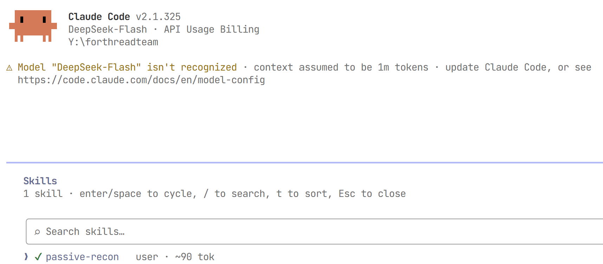
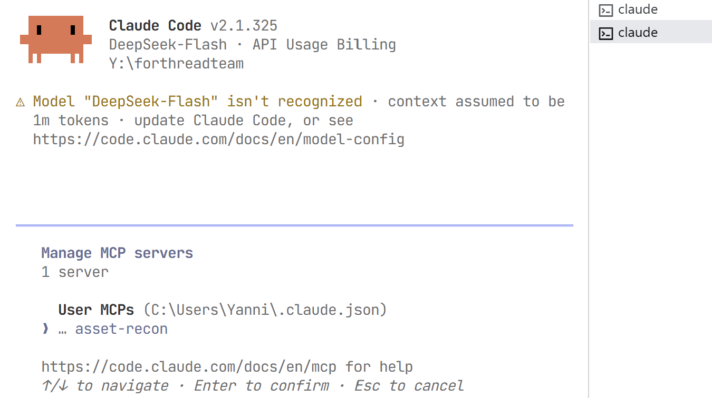
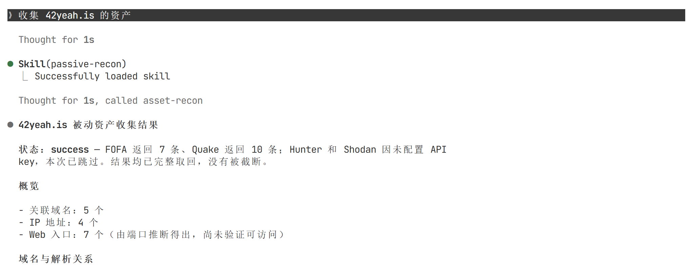
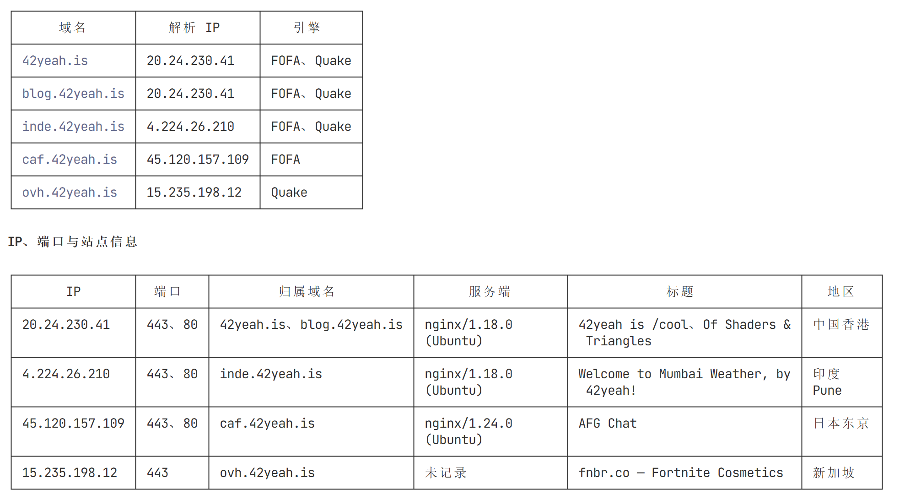
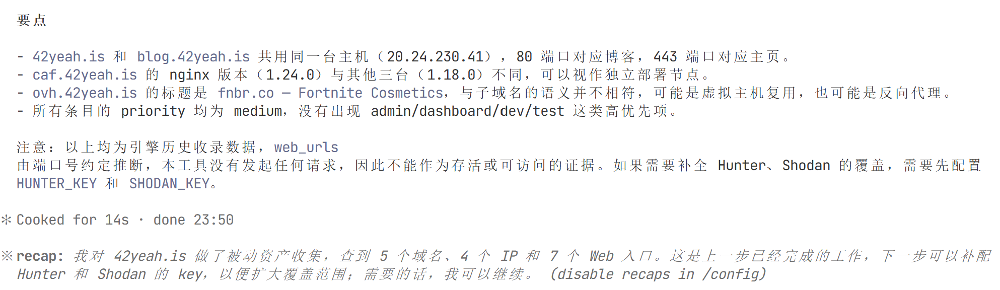

# 资产收集 MCP server

看到作业的时候，我首先想的是写一个资产收集的 MCP server——这样就能在很多 MCP client（Claude Code、Kimi CLI 等）上复用。

下面先写我对老师项目的理解，再写我这个项目是怎么设计的(时间没有安排好，写的太过粗糙，Rj老师多多担待)，最后是它支持什么、哪些地方对应了作业要求、哪些还没做，以及我还没想清楚的问题。

***

## 1. 我对英招项目的理解

### 1.1 编排在系统提示里，不在代码里

老师的这个项目我理解是把 Trae 当作一个 agent 来用，信息收集的四层写在 `.trae/system-prompt.md` 里：

```
被动测绘 → 指纹采集 → 主动探测 → 资产分析
```

模型读到这段流程后，依据各 `SKILL.md` 的 **description** 决定要不要加载某个 skill；加载之后，正文里的「适用触发」起到一个加载后二次确认的作用。

### 1.2 我卡住的地方：skill 到脚本之间是断的（需要老师解答一下，谢谢！）

以 `skills/cyberspace-recon/SKILL.md` 为例，里面写的是**方法论**（7 种搜索模式、翻页策略、分层存储、输出格式），一条可执行命令都没有。

真正去执行信息收集脚本的命令在 `.trae/task-templates.md` 里，比如：

```bash
python3 .trae/scripts/cyberspace_collect.py <target>
```

那agent读完 `cyberspace-recon/SKILL.md` 之后，是如何去读`task-templates.md`，从而去真的开展任务的呢？卡在了从skill到实际运行脚本这一块。

### 1.3 skill 之间靠 `signals/*.json` 传数据，同一份数据有三种描述

**第一种：统一信封** —— `templates/signal.schema.json`

```json
"properties": {
  "schema_version": { "type": "integer", "const": 1 },
  "source_skill": { "type": "string" },
  "created_at": { "type": "string", "format": "date-time" },
  "data": { "type": "object", "description": "Skill-specific structured data" }
}
```

它只规定外壳必须是这四个字段，`data` 被声明为任意 object。所以这一层**拦不住内容错误**，实际只能检查"缺 `schema_version` / 缺 `source_skill`"这类信封级问题（`validate_signals.py` 做的就是这个）。

**第二种：接口说明** —— 各 `SKILL.md` 的「信号输出格式」小节。每个 skill 手写一段 JSON 示例说明自己 `data` 里有什么字段，给人和模型看，不参与运行。

**第三种：运行时事实** —— 生产脚本里的字面量，比如 `cyberspace_collect.py` 里的 `signal = {...}`。这才是真正被写出去的东西，下游脚本按这里的字段名硬编码读取，取不到时用 `.get()` 默认值兜底，或者换算法降级。

### 1.4 最后产出什么

走完四阶段、7 个 skill 之后（这 7 个 skill 内部还有很多细节我还没有细看），agent 调 `export_report.sh` 产出三样东西：

1. 一份报告文件（md / json / html 三种格式）
2. 一个完整的 run 目录（signals、findings、原始归档等全量证据）
3. 一段给用户看的对话摘要

***

## 2. 我的设计

### 2.1 总述

整个资产收集封装成一个MCP server，该MCP server提供一个方法 `collect_assets` ，接收输入为：target和mode。然后里面每一个资产测绘的引擎都单独写成一个文件，放在providers里（这里是直接拆老师项目的脚本YingZhao-main\YingZhao-main\.trae\scripts\cyberspace_collect.py，拆成四引擎采集 + 归一化 + 去重六个文件），然后将结果以json形式返回给MCP client。

写完发现，自己只是做了一个老师项目拆分的工作，甚至还没拆分完整。。。

### 2.1 输入

```
collect_assets(target, mode)
```

`target` 是唯一必填项，可以传域名、IP、CIDR，也可以直接贴 URL（内部会清洗）。`mode` 是可选参数，默认按 target 的类型自动推断。

### 2.2 输出

一个 JSON 结构体，交给 LLM 分析。11 个字段，例如：

```jsonc
{
  "schema_version": "1.0",
  "run_id": "20261114T153934Z-42yeah.is",
  "target": "42yeah.is",
  "target_type": "domain",          // domain / ip / cidr / unknown
  "query_mode": "domain_expand",
  "status": "success",              // success / empty / unconfigured / failed / invalid_target
  "query_summary": { "fofa": {"status": "ok", "total": 7, "fetched": 7, "has_more": false, "elapsed_ms": 812, "error": null} },
  "observations": [],
  "derived": { "subdomains": [], "ip_addresses": [], "web_urls": [], "root_domains": [] },
  "stats": { "observations": 0, "returned": 0, "truncated": false, "providers_succeeded": 2, "providers_failed": 0 },
  "artifact": null,
  "error": null
}
```

***

## 3. 开发步骤
我先写的是server.py这个文件，也是我整个MCP server的入口文件。
### 3.1 第 1 步：清洗 target

复用老师的 `clean_host` 思路

### 3.2 第 2 步：判断类型，决定默认 mode

这应该也是老师的思路，我自己没有设计，要么是AI的思路。判定顺序:

```
含有 "/"          → cidr
ip_address() 成功  → ip
匹配域名正则       → domain
其余              → unknown
```

必须先判 `/` 再判 IP：`ipaddress.ip_network("192.0.2.10")` 会成功返回一个 `/32`，先走 IP 分支的话 CIDR 会被错判成单 IP。

`unknown` 直接短路，不发任何请求，返回 `status: invalid_target`。

类型出来之后 `mode` 就有了默认值（domain → `domain_expand`，ip → `ip_scan`，cidr → `cidr_scan`）。

### 3.3 第 3 步：先接 FOFA，把链路打通

一开始只接了 FOFA，用老师的 `collect_fofa`，目的是先确认"引擎能查、结果能返回给宿主"这条链路是通的。

### 3.4 第 4 步：加 runner.py，把老师的函数包成 MCP 能用的形态

`collect_one(name, target)` 做三件事：

| 做的事                                       | 为什么必须在这做                                                                                                                                                  |
| ----------------------------------------- | --------------------------------------------------------------------------------------------------------------------------------------------------------- |
| `asyncio.to_thread(collect_fofa, target)` | 老师的函数是同步阻塞的，直接调会把 MCP 的事件循环卡死                                                                                                                             |
| `redirect_stdout(sys.stderr)`             | 老师满屏 `print`，stdout 被污染 MCP 协议就崩了                                                                                                                         |
| summary 归一化                               | 四种引擎返回值不统一（fofa/hunter/shodan 是 `ok/total/fetched`，quake 可能给 `empty`/`ok_partial`，没 key 给 `skipped`），统一成 `status/total/fetched/has_more/elapsed_ms/error` |

`collect_all(target)` 按 fofa → hunter → quake → shodan 顺序串行跑，返回 `query_summary` 和四个引擎 entry 直接拼接的 `entries`。

老师 `main()` 里看着没有异常保护，一个引擎抛异常可能整个采集就挂了。所以我在 **`collect_one` 内部**套了一层 `try/except`，把异常转成该引擎的 `error` 字段返回。

### 3.5 第 5 步：补齐另外三个引擎，接上老师的数据处理

从老师文件里把 Hunter、Quake、Shodan 按节拆成独立模块，加上已有的 FOFA，`providers/` 就是四份**函数体**的实现。去重合并（`dedup_and_merge`）、派生（`extract_subdomains` / `extract_web_urls`）、优先级打分，全部用老师的方法，写在了merge.py里。

唯一有逻辑改动的是 `fofa.py`，共 2 处适配：

1. 请求基址改成可配置的 `FOFA_BASE_URL`，并且只校验 `FOFA_KEY`，不再要求 `FOFA_EMAIL`（我用的是中转站，不需要邮箱）
2. 翻页上限读取 `FOFA_MAX_PAGES`，到上限 `break`（由于是付费API 就限制一下，只是测可用，先不管收集的全不全）

### 3.6 第 6 步：把结果变成"可引用的观测"

这是我相对老师多出来的一层。老师的出口是扁平的 `assets` 列表，LLM 拿到之后还得自己算"这个 IP 上有哪些域名"。

所以我加了 `observations`：每条带 `type`、`key`、`data`、`sources`、`confidence`。

| type           | 含义                                          |
| -------------- | ------------------------------------------- |
| `dns_name`     | 一个域名，聚合它的全部 IP                              |
| `ip_address`   | 一个 IP，聚合它的端口和挂载域名                           |
| `service`      | 一条引擎记录（IP:Port + title + server + 国家 + 优先级） |
| `web_endpoint` | 按端口约定拼出来的 URL                               |

`confidence` 只分两档：`recorded`（引擎直接说的事实）和 `inferred`（按规则算出来的）。

### 3.7 第 7 步：写 skill，让 client 优先调这个 tool

让Claude Code 看到"资产收集"任务时，不自己开 WebSearch / WebFetch 去搜网页，而是调用写好的skill。

`skills/passive-recon/SKILL.md` 只有五节：什么时候用（目前写了"不要用 WebSearch / WebFetch 代替"这条硬约束，感觉还是不太会skill的加载与应用，这里实现有点笨笨的）、怎么调、结果怎么判读、怎么汇报、红线。


### 3.8 第 8 步：测试

skill 装到 Claude Code 的 `~/.claude/skills/<name>/SKILL.md`  目录下，验证claude code确实读取到了：


先用 `claude mcp list` 确认 server 连上，再用真实 API 跑。



使用fofa和quake引擎，跑`42yeah.is`（怕花太多FOFA API的钱，找了朋友写的站去测，验证可用性，没有考虑完善性），FOFA 7 条 + Quake 10 条，去重后 6 条资产、23 条 observations，两个引擎 `ok`







***

## 4. 现在支持什么

- **四引擎聚合**：FOFA / Hunter / Quake / Shodan，任意引擎缺失或报错都不影响其它引擎
- **输入容错**：域名 / IP / CIDR / 带协议的 URL 都能吃，自动判类型
- **去重合并**：跨引擎按 `ip:port` → `host:port` → `ip` → `host` 优先级归并，合并来源、补齐空字段
- **优先级标记**：按 title 关键词、host 关键词、非标准端口、敏感端口打 high / medium / low
- **派生视图**：子域名、IP 列表、Web URL
- **结构化观测**：`dns_name` / `ip_address` / `service` / `web_endpoint` 四类，带来源与置信度
- **可解释的空结果**：`query_summary` 区分"没资产"和"引擎失败"

***

## 5. 哪些地方对应了作业要求

| 作业要求                              | 我的落点                                                                           |
| --------------------------------- | ------------------------------------------------------------------------------ |
| 配置至少 2 个测绘引擎 API key              | FOFA（中转站）+ Quake，实测 `providers_succeeded: 2`                                   |
| 设计一套 MCP + tools + skill 的 AI 工具链 | `server.py`（MCP server）→ `collect_assets`（tool）→ `SKILL.md`（skill，拦住模型不让它去搜网页） |

***

## 6. 不支持什么 / 还没做

- **只覆盖 7 个环节里的第 1 个**：httpx 探活、favicon 关联、JARM、host 碰撞、资产分析、报告导出全部没接
- **7 种搜索模式只落地 1 种**：只有 `domain_expand` 真正生效。选 `ip` / `cidr` 只会改变返回的标签，四个 provider 里的查询串仍然写死 `domain="<target>"`，所以传 IP / CIDR 会得到空结果而不是报错——这是最容易被误读成"目标没资产"的地方
- **组织画像、证书关联、favicon hash、指纹组合**：没有参数入口
- **不落盘、不出报告**：老师会写 `signals/recon-assets.json`、`recon-archive/<engine>-<ts>.json`、`run.json`、`current-run.txt`，并用 `export_report.sh` 出 md / json / html 三份报告；我这里 `artifact` 恒为 `null`
- **不递归**：favicon / JARM 命中新资产后二次测绘（深度上限 2）没做
- **不做实时验证**：`web_endpoint` 全是拼出来的 URL，没有探活、没有状态码
- **没有 signals 校验与测试**：老师的 `validate_signals.py` 和任何单测都没有对应物
- **鉴权失败可能被误判为 empty**：上游返回 401 / 400 时，部分引擎表现为 `ok` + 0 条，`query_summary` 里看不出鉴权失败

***

## 8. 需要老师解答的问题

**1. 老师这种写法，后面这个 agent 能单独剥离出来吗？到底该写 MCP server 还是写老师这样的 agent？**


**2. 空间测绘类的 MCP server，应该一个引擎一个 server，再由一个编排 server 调用，还是像我这样四引擎写在一个 server 里？**

zoomeye 有官方的空间测绘 MCP server，所以我会想这个结构问题。我倾向写成一个 server：tool 之间传 JSON 的开销和上下文膨胀远大于进程内函数调用。

**3. 老师 7 个 skill，能不能改成 1 个 server 暴露 7 个 tool，再用一个总 skill 把顺序串起来？这样写对吗？以及我怀疑自己的 MCP tool 没有 LLM 读 skill 灵活。**

我现在只写了一个skill，如果按照我这种一个mcp server的设计的话，我感觉老师的七个skill，我可以暴露成一个mcp server的7个tool，然后用一个总的skill来把这7个tool的顺序串联起来。这样写对吗？然后我现在很怀疑自己写的mcp tool没有LLM读skill灵活？